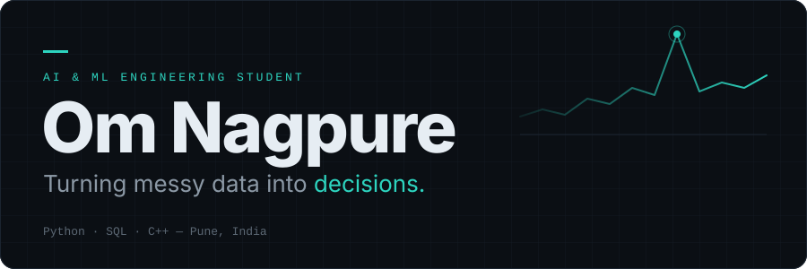
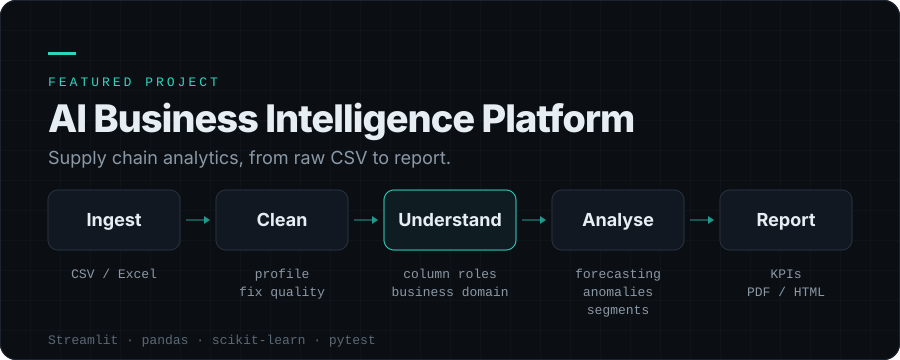
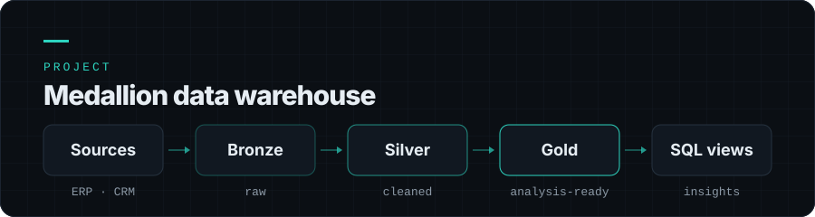
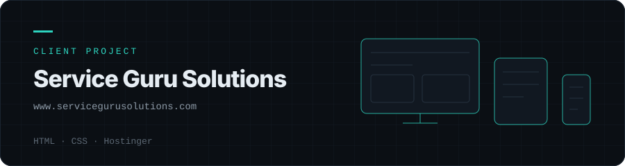
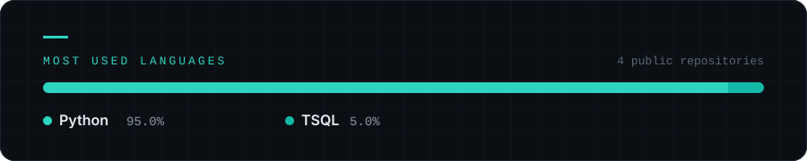

  

  Final-year B.E. in Artificial Intelligence &amp; Machine Learning 
  PES Modern College of Engineering, Pune

 

##  &nbsp;About

I'm a final-year AI & ML engineering student currently developing an AI-powered Business Intelligence platform using Python. The project focuses on processing raw supply chain data, identifying column semantics, and generating actionable insights through forecasting, anomaly detection and automated reporting.

I care about writing maintainable code, testing my implementations and understanding the engineering decisions behind what I build.

Currently strengthening my foundations in data structures, algorithms and software design while looking to gain experience working on real-world engineering problems.

**Education** &nbsp;B.E. AI &amp; ML, 2023 – 2027 
**Focus** &nbsp;Python, Data Structures & Algorithms, Applied Machine Learning

 

##  &nbsp;Tech Stack

<table>
  <tr>
    <td><b>LANGUAGES</b></td>
    <td>
      
      
      
      
      
    </td>
  </tr>
  <tr>
    <td><b>DATA &amp; ML</b></td>
    <td>
      
      
      
      
      
    </td>
  </tr>
  <tr>
    <td><b>APPS &amp; DATABASE</b></td>
    <td>
      
      
    </td>
  </tr>
  <tr>
    <td><b>TOOLS</b></td>
    <td>
      
      
      
      
    </td>
  </tr>
</table>

Core Concepts: Data Structures &amp; Algorithms · Object-Oriented Programming · DBMS · ETL · Data Modeling

 

##  &nbsp;Projects

An end-to-end supply chain analytics app. It cleans raw CSV / Excel data and produces KPIs, an interactive dashboard and PDF / HTML reports. It runs locally and needs no external AI API.

- **Understands the data it's given.** A column-meaning detector combines rules with a TF-IDF and Logistic Regression model, then infers the business domain.
- **Analysis layer.** Holt-Winters / ARIMA forecasting, Isolation Forest anomaly detection and KMeans supplier segmentation.
- **Explainable output.** A rule-based insight engine links every recommendation to its evidence.
- **Tested.** 300+ pytest tests; validated on a 180k-row dataset.

`Python` · `Streamlit` · `pandas` · `scikit-learn` · `statsmodels` · `ReportLab` · `pytest` 
**[View repository →](https://github.com/omnagpure/AI-Business-Intelligence-Platform)**

<!--
  Screenshot slot: only add a real capture of the running app, e.g.
  
-->

 

A data warehouse in SQL Server built on the Medallion architecture, with ETL pipelines that load ERP and CRM source data.

- Bronze (raw), Silver (cleaned) and Gold (analysis-ready) layers.
- ETL that cleans, standardises and integrates data across layers.
- SQL views for customer behaviour, product performance and sales trends.

`SQL Server` · `SQL` · `ETL` · `Data Modeling` 
**[View repository →](https://github.com/omnagpure/Data-Warehouse-Analytics-Project)**

 

 

A responsive website built for a client, published on a live domain via Hostinger. The layout adapts across phones, tablets and desktops.

`HTML` · `CSS` 
**[Visit site →](https://www.servicegurusolutions.com)**

 

##  &nbsp;Currently Learning

- **C++** — data structures and algorithms
- **Python** — application development
- **Software engineering** — fundamentals and testing practice
- **Applied AI / ML** — turning models into usable tools

Certifications: C++ Training and Python for Machine Learning (Spoken Tutorial Project, IIT Bombay) · Introduction to TensorFlow for AI, ML &amp; Deep Learning (DeepLearning.AI)

 

##  &nbsp;Statistics

  

 

##  &nbsp;Connect

 

  <i>"I owe it to myself to be the person I need."</i> 
  — Om Nagpure,   in case you wondered.

